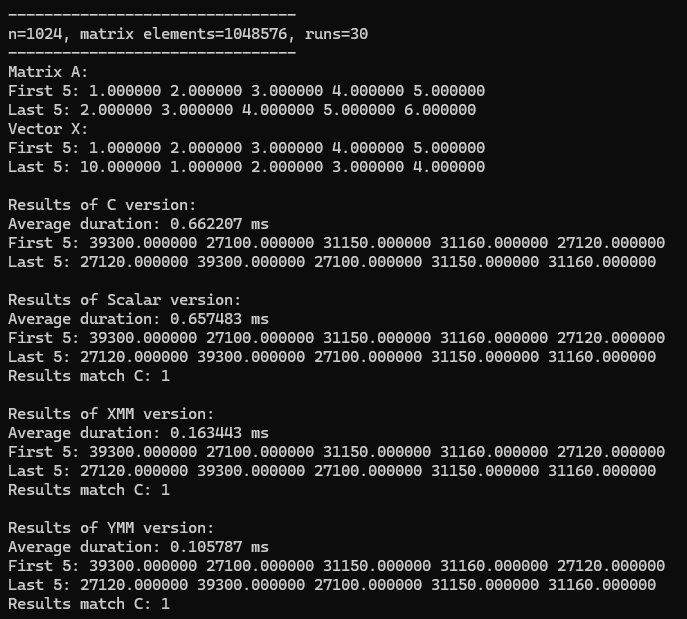
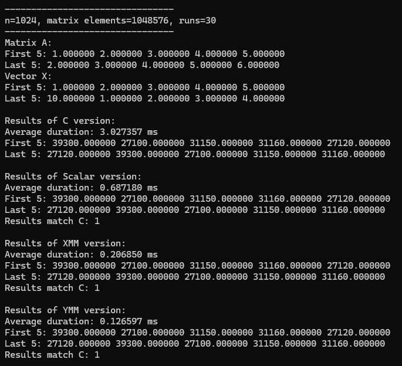
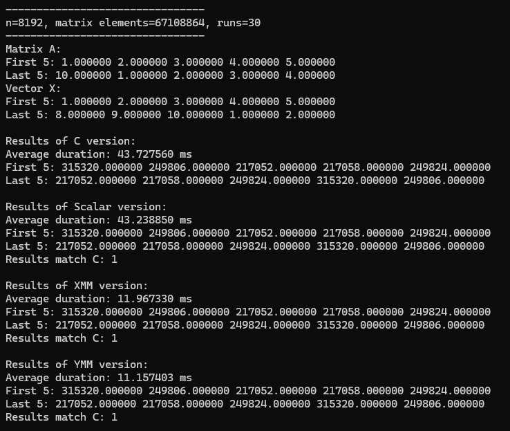
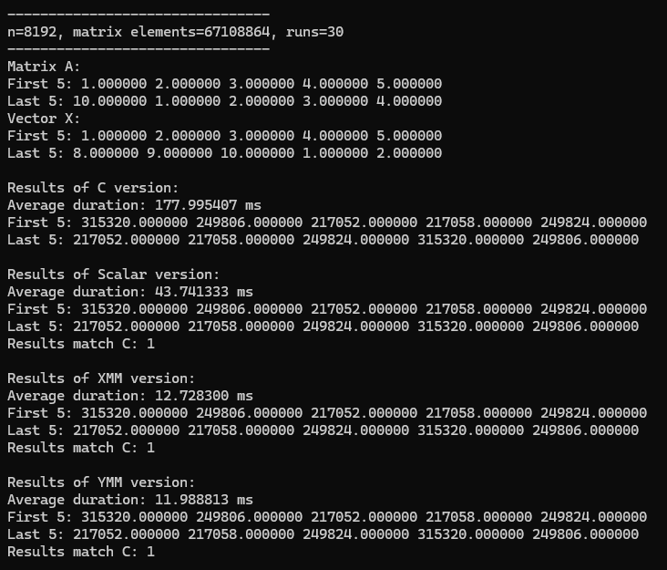
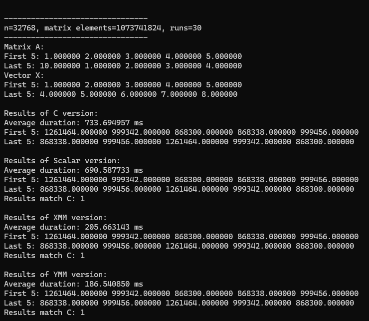
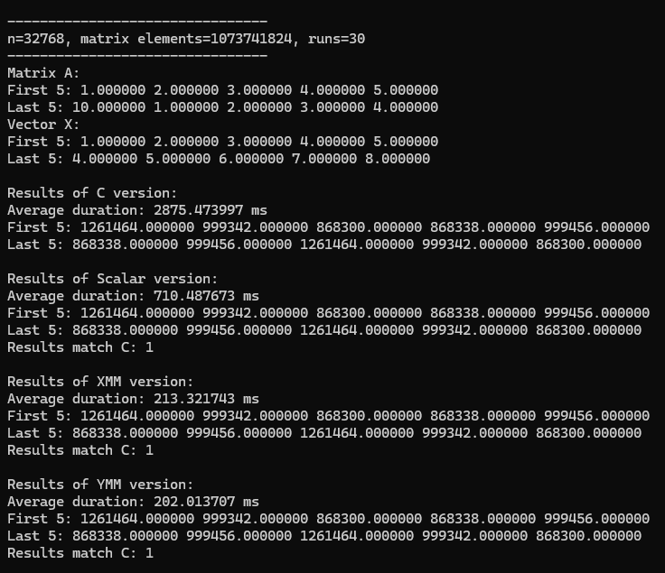
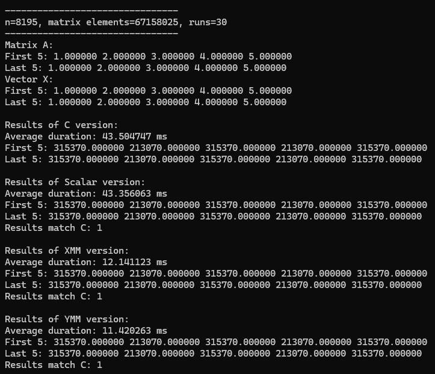
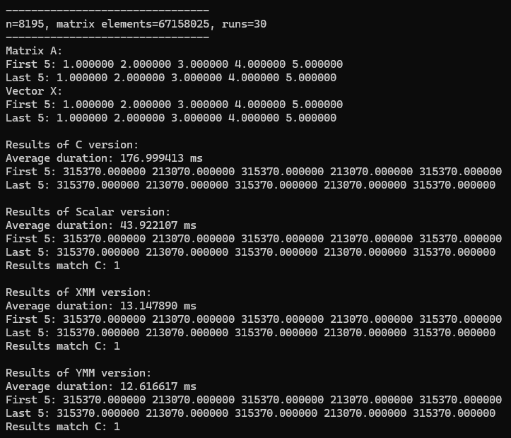

# Deep Dive SIMD Programming Project
Group #5

Members:
- Julian Johan Briones
- Ramon John Dela Cruz
- Anthony Andrei Tan

## Program output screenshots

| Matrix size | Release | Debug |
| --- | --- | --- |
| n = 1,024 (2^10) 1,048,576 matrix elements (2^20) |  |  |
| n = 8,192 (2^13) 67,108,864 matrix elements (2^26) |  |  |
| n = 32,768 (2^15) 1,073,741,824 matrix elements (2^30) |  |  |
| n = 8,195 (2^13 + 3) 67,158,025 matrix elements; boundary checks: n % 4 = 3, n % 8 = 3 |  |  |

## ii. Comparative Table of Execution Times

| Matrix Size (n) | Kernel        | Avg. Time (ms) | Speedup vs. C | Speedup vs. Scalar |
| :-------------: | :------------ | :------------: | :-----------: | :----------------: |
|    **1,024**    | C             |     0.662      |      ---      |       0.99×        |
|                 | Scalar (NASM) |     0.657      |     1.01×     |        ---         |
|                 | XMM (128-bit) |     0.163      |     4.06×     |       4.03×        |
|                 | YMM (256-bit) |     0.106      |     6.25×     |       6.20×        |
|    **8,192**    | C             |     43.728     |      ---      |       1.00×        |
|                 | Scalar (NASM) |     43.239     |     1.01×     |        ---         |
|                 | XMM (128-bit) |     11.967     |     3.65×     |       3.61×        |
|                 | YMM (256-bit) |     11.157     |     3.92×     |       3.88×        |
|    **8,195**    | C             |     43.505     |      ---      |       1.00×        |
|                 | Scalar (NASM) |     43.356     |     1.00×     |        ---         |
|                 | XMM (128-bit) |     12.141     |     3.58×     |       3.57×        |
|                 | YMM (256-bit) |     11.420     |     3.81×     |       3.80×        |
|   **32,768**    | C             |    733.695     |      ---      |       1.06×        |
|                 | Scalar (NASM) |    690.588     |     1.06×     |        ---         |
|                 | XMM (128-bit) |    205.663     |     3.57×     |       3.36×        |
|                 | YMM (256-bit) |    186.541     |     3.93×     |       3.70×        |

## viii. Analysis of Results Across Platforms
At n = 1,024, YMM finishes only 0.551 ms ahead of scalar execution. Increasing matrix size to n = 8,192 widens this margin to 32.082 ms as scalar processing time climbs to 43.239 ms. At the maximum dimension of n = 32,768, the absolute time saved expands dramatically: YMM finishes 504.047 ms faster than scalar execution and outpaces the 128-bit XMM kernel by an additional 19.122 ms. Because total arithmetic operations scale quadratically, the real-world efficiency of 256-bit SIMD registers compounds as dimensions increase, eliminating over half a second per execution on large matrices. This means that the size is directly proportional to the result in differences as the comparison just keeps increasing from there.

## ix. Problems Encountered and Solutions Made
When implementing matvec_scalar.asm, a problem encountered is managing the Windows x64 calling convention, where only the first four arguments reside in registers and the fifth argument for vector Y must be correctly retrieved from stack memory at [rsp + 40]. Another frequent challenge is converting and analyzing two-dimensional matrix indexing into assembly without recalculating row-major offsets on every iteration. Instead of executing repeated multiplication instructions for row offsets, the inner loop was simplified to advance the matrix pointer sequentially by 4 bytes per float. Finally, coordinating nested row and column loops required proper register management to ensure the floating-point accumulator properly cleared to zero before computing each subsequent row dot product.

For the matvec_simd_ymm.asm kernel, one challenge that we encountered during implementation was that the YMM register could only hold 8 32-bit floats at a time and handling column lengths that were not divisible by 8. So, what we did was to round the number to a multiple of 8, and a clever solution we did for getting that was "shr x, 3" "shl x, 3". This essentially does //8 (floor division) and multiplies by 8 again, so it scraps the remainder. Then, the remainder was simply just processed in a scalar loop. Consequently, when getting the sum for each [i][j], vhaddps only combined each 128-bit half of the YMM register, so our solution to that was to split the ymm first using vextractf128 to get the other half, vaddps the 2 values from the 128-bit halves, and lastly do the vhaddps.
